<!-- Visual assets live in ./assets and are generated by tools/generate_assets.py -->

<picture>
  <source media="(prefers-color-scheme: dark)" srcset="./assets/hero-dark.svg">
  <source media="(prefers-color-scheme: light)" srcset="./assets/hero-light.svg">
  
</picture>

  <a href="https://github.com/Saud-Khan-Dev">GitHub</a>&nbsp;&nbsp;·&nbsp;&nbsp;<a href="https://www.linkedin.com/in/saud-khan-776a49286">LinkedIn</a>&nbsp;&nbsp;·&nbsp;&nbsp;<a href="mailto:asaud3508@gmail.com">Email</a>&nbsp;&nbsp;·&nbsp;&nbsp;<a href="https://saud-khan.lovable.app/">Portfolio</a>&nbsp;&nbsp;·&nbsp;&nbsp;<a href="https://archlinux.org/">Arch&nbsp;Linux</a>

 

  <picture>
    <source media="(prefers-color-scheme: dark)" srcset="./assets/terminal-dark.svg">
    <source media="(prefers-color-scheme: light)" srcset="./assets/terminal-light.svg">
    
  </picture>

 

## About

I'm a software engineer who cares about the shape of a system as much as the code inside it. Most of my work happens on the backend — .NET services organised with **Clean Architecture**, **Domain-Driven Design** and **CQRS** — and I like carrying an idea all the way through to a polished interface in Next.js, Angular or Flutter.

What I'm drawn to:

- **Architecture** — clear boundaries, explicit domains, and systems that stay easy to change as they grow.
- **Distributed systems** — microservices, API gateways, messaging and event-driven communication.
- **Performance** — measuring first, then making things fast in the places that matter.
- **Frontend craft** — interfaces that feel quick, calm and considered, on the web and on mobile.
- **AI & data** — LLM-powered features today; Rust for data processing and machine learning as a growing interest.
- **Linux & open source** — Arch Linux as a daily driver, containers, and good developer tooling.

> **How I like to build** &nbsp;·&nbsp; Clear boundaries over clever code. Optimise for change, then for speed. Measure before tuning. Details are part of the product.

 

<picture>
  <source media="(prefers-color-scheme: dark)" srcset="./assets/divider-dark.svg">
  <source media="(prefers-color-scheme: light)" srcset="./assets/divider-light.svg">
  
</picture>

## Selected work

### QEC Multi-Tenant Platform
<code>.NET</code> <code>ASP.NET Core</code> <code>EF Core</code> <code>SQL Server</code> <code>MediatR</code> <code>Redis</code> <code>Clean Architecture</code> <code>DDD</code> <code>CQRS</code>

A platform for **institutional quality and performance management**, where many institutions share one system while keeping their data apart.

- **Layered by design** — separate Domain, Application, Infrastructure, Contract and Web API projects keep business rules independent of frameworks and storage.
- **CQRS with MediatR** — use cases are modelled as explicit commands and queries, with request validation through FluentValidation.
- **Multi-tenancy** — tenant isolation is treated as a first-class concern and covered by dedicated tests.
- **Platform** — EF Core on SQL Server, JWT bearer authentication and Redis caching.

Private repository

### AI Linguistics Engine
<code>Next.js</code> <code>TypeScript</code> <code>Google Gemini API</code> <code>MongoDB</code> <code>NextAuth</code> <code>Redux Toolkit</code> <code>Tailwind CSS</code>

A language-practice app that uses a large language model to **correct grammar and coach learners** in the language they're studying.

- **AI features as API routes** — dedicated Next.js endpoints for grammar correction, conversation, vocabulary and object naming, each calling Gemini on the server so keys never reach the browser.
- **Per-learner context** — authenticated sessions with NextAuth and learner data stored in MongoDB.
- **Voice** — spoken interaction through the ElevenLabs React SDK.

<a href="https://github.com/Saud-Khan-Dev/Practice-Language-using-AI">Repository</a>

### Micro-Blog Platform
<code>Next.js</code> <code>Node.js</code> <code>MongoDB</code> <code>Mongoose</code> <code>NextAuth</code> <code>Tailwind CSS</code>

A full-stack blogging platform focused on **secure authentication and a clean writing experience**.

- **Authentication** — NextAuth with GitHub OAuth and email/password credentials.
- **Data layer** — MongoDB models through Mongoose, accessed from server actions and API routes.
- **Writing** — a Markdown editor for composing and previewing posts.

### High-Fidelity OCR Engine
<code>Angular</code> <code>TypeScript</code> <code>Tesseract.js</code> <code>Web Workers</code> <code>Tailwind CSS</code>

Extracts text from images **entirely in the browser** — nothing is uploaded to a server.

- **Client-side OCR** — Tesseract.js runs recognition locally, which keeps images private and needs no backend.
- **Off the main thread** — recognition runs in a Web Worker, so the interface stays responsive while an image is processed.

<a href="https://github.com/Saud-Khan-Dev/Extraction_Text_From_Image-Angular">Repository</a>&nbsp;&nbsp;·&nbsp;&nbsp;<a href="https://extraction-text-from-image-angular.vercel.app">Live demo</a>

 

<b>More from the workshop</b>

 

- **[ERP Backend](https://github.com/Saud-Khan-Dev/ERP-Backend)** — .NET microservices for Identity, HRM, Assets, Property and Taxation behind a YARP API gateway; PostgreSQL, MediatR, Carter and JWT.
- **[EShop Microservices](https://github.com/Saud-Khan-Dev/EShopMicroservices)** — Catalog, Basket, Discount and Ordering services communicating over RabbitMQ (MassTransit) and gRPC, with Redis, Marten and PostgreSQL.
- **[Bank Microservices](https://github.com/Saud-Khan-Dev/spring-boot-bank-microservices)** — Accounts, Loans and Cards services in Spring Boot 4 with OpenAPI docs, validation, JPA auditing and container images built with Jib.
- **[Task Management API](https://github.com/Saud-Khan-Dev/Task-management-Nest-js)** — NestJS and TypeORM with JWT authentication through Passport.
- **[Markdown → HTML in Rust](https://github.com/Saud-Khan-Dev/Markdown-to-HTML-in-RUST)** — a small Markdown-to-HTML converter written in Rust.
- **[Solana Todo](https://github.com/Saud-Khan-Dev/solana_todo_app)** — a Solana program in Rust with a TypeScript client.
- **[Flutter Clean Architecture Blog](https://github.com/Saud-Khan-Dev/blog_app_flutter_clean_architecture)** — a Flutter app structured with Clean Architecture.

 

<picture>
  <source media="(prefers-color-scheme: dark)" srcset="./assets/divider-dark.svg">
  <source media="(prefers-color-scheme: light)" srcset="./assets/divider-light.svg">
  
</picture>

## Toolkit

**Languages**

Plus SQL across SQL Server and PostgreSQL.

**Backend & architecture**

ASP.NET Core · REST APIs · Microservices · YARP · Event-driven messaging · CQRS & MediatR · Clean Architecture · DDD · SOLID · JWT authentication & authorization

**Frontend & mobile**

Redux Toolkit · Bloc state management

**Data**

Microsoft SQL Server · Entity Framework Core · Marten · Mongoose · TypeORM

**AI & machine learning**

LLM integration (Google Gemini, OpenAI APIs) · OCR with Tesseract.js · AI-assisted language processing 
<i>Exploring:</i> Polars for data processing and Linfa for machine learning in Rust

**Infrastructure & tooling**

Containerised services · Jib & buildpacks · CI/CD concepts

 

<picture>
  <source media="(prefers-color-scheme: dark)" srcset="./assets/divider-dark.svg">
  <source media="(prefers-color-scheme: light)" srcset="./assets/divider-light.svg">
  
</picture>

## Activity

  
  

  

 

<picture>
  <source media="(prefers-color-scheme: dark)" srcset="./assets/footer-dark.svg">
  <source media="(prefers-color-scheme: light)" srcset="./assets/footer-light.svg">
  
</picture>
